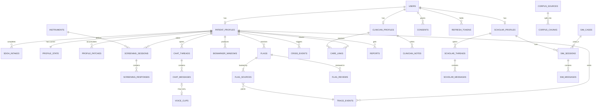

# Backend Schema

Related: [[TRD]] · [[API]] · [[Decisions#ADR-004]]

PostgreSQL 16 with `pgvector`, `pgcrypto`, `citext`. Five schemas separate the data worlds:

| Schema | Holds | Who can read |
|---|---|---|
| `core` | users, auth, consents, clinician profiles, instruments | all app roles (column grants limit sensitive fields) |
| `patient` | everything a patient produces | `zs_patient_app` (own rows via RLS), `zs_clinician_app` (linked rows via RLS), `zs_worker` |
| `clinical` | clinician notes and flag reviews | `zs_clinician_app`, `zs_worker` |
| `scholar` | corpus, tutor threads, simulator, learner profiles | `zs_scholar_app`, `zs_admin_app`, `zs_worker` |
| `audit` | append-only event log | insert: all app roles; select: `zs_admin_app` |

`zs_scholar_app` has **no** usage grant on `patient` or `clinical`. That grant list is the enforcement of "no cross-contamination".

Conventions: UUID v7 primary keys (time-ordered), `timestamptz` everywhere, `snake_case`, enums as Postgres enum types, encrypted columns suffixed `_enc` (bytea, AES-GCM at the application layer).

## ER overview



## DDL

### Extensions and types

```sql
CREATE EXTENSION IF NOT EXISTS pgcrypto;
CREATE EXTENSION IF NOT EXISTS citext;
CREATE EXTENSION IF NOT EXISTS vector;

CREATE SCHEMA core; CREATE SCHEMA patient; CREATE SCHEMA clinical;
CREATE SCHEMA scholar; CREATE SCHEMA audit;

CREATE TYPE core.user_role      AS ENUM ('patient','scholar','clinician','admin');
CREATE TYPE core.user_status    AS ENUM ('active','pending_verification','suspended','deleted');
CREATE TYPE core.consent_type   AS ENUM ('terms','screening_disclaimer','ai_processing',
                                         'webcam_metrics','voice_processing',
                                         'research_recording','clinician_sharing');
CREATE TYPE core.verification   AS ENUM ('pending','approved','rejected');
CREATE TYPE patient.session_status AS ENUM ('in_progress','completed','aborted_crisis','abandoned');
CREATE TYPE patient.trigger_source AS ENUM ('manual','counselor_suggest','profiler_suggest','scheduled');
CREATE TYPE patient.event_type  AS ENUM ('sdoh_answer','item_answer','chat_message',
                                         'voice_clip','biomarker_window','crisis');
CREATE TYPE patient.flag_severity AS ENUM ('info','watch','urgent','crisis');
CREATE TYPE patient.flag_status AS ENUM ('open','acknowledged','resolved');
CREATE TYPE patient.link_status AS ENUM ('pending','active','revoked');
CREATE TYPE patient.detector    AS ENUM ('lexicon','classifier','item_rule','manual_help');
CREATE TYPE patient.marker_source AS ENUM ('browser_mediapipe','server_research');
CREATE TYPE scholar.level       AS ENUM ('intro','intermediate','advanced','research');
CREATE TYPE scholar.source_kind AS ENUM ('dsm','textbook','guideline','paper','vignette');
```

### core

```sql
CREATE TABLE core.users (
  id              uuid PRIMARY KEY,
  email           citext UNIQUE NOT NULL,
  password_hash   text NOT NULL,                 -- argon2id
  role            core.user_role NOT NULL,
  status          core.user_status NOT NULL DEFAULT 'active',
  display_name    varchar(80) NOT NULL,
  birth_year      smallint CHECK (birth_year BETWEEN 1900 AND 2100),
  locale          varchar(10) NOT NULL DEFAULT 'en',
  created_at      timestamptz NOT NULL DEFAULT now(),
  last_login_at   timestamptz,
  deleted_at      timestamptz
);

CREATE TABLE core.refresh_tokens (
  id            uuid PRIMARY KEY,
  user_id       uuid NOT NULL REFERENCES core.users(id) ON DELETE CASCADE,
  family_id     uuid NOT NULL,                   -- rotation family for reuse detection
  token_hash    bytea NOT NULL UNIQUE,
  expires_at    timestamptz NOT NULL,
  revoked_at    timestamptz,
  user_agent    text,
  created_at    timestamptz NOT NULL DEFAULT now()
);

CREATE TABLE core.mfa_totp (
  user_id       uuid PRIMARY KEY REFERENCES core.users(id) ON DELETE CASCADE,
  secret_enc    bytea NOT NULL,
  enabled_at    timestamptz,
  recovery_hashes text[] NOT NULL DEFAULT '{}'
);

CREATE TABLE core.consents (
  id            uuid PRIMARY KEY,
  user_id       uuid NOT NULL REFERENCES core.users(id) ON DELETE CASCADE,
  consent_type  core.consent_type NOT NULL,
  doc_version   varchar(20) NOT NULL,            -- version of the consent text shown
  granted_at    timestamptz NOT NULL DEFAULT now(),
  revoked_at    timestamptz
);
CREATE UNIQUE INDEX consents_active ON core.consents(user_id, consent_type) WHERE revoked_at IS NULL;

CREATE TABLE core.clinician_profiles (
  user_id        uuid PRIMARY KEY REFERENCES core.users(id) ON DELETE CASCADE,
  full_name      varchar(120) NOT NULL,
  license_no     varchar(60),
  institution    varchar(160) NOT NULL,
  specialty      varchar(120),
  proof_key      text,                            -- object key of uploaded ID document
  verification   core.verification NOT NULL DEFAULT 'pending',
  verified_by    uuid REFERENCES core.users(id),
  verified_at    timestamptz,
  invite_code    varchar(12) UNIQUE               -- set on approval
);

CREATE TABLE core.instruments (
  id            uuid PRIMARY KEY,
  code          varchar(20) NOT NULL,             -- 'PHQ9','GAD7','CSSRS_SCREEN','WHO5','ISI'
  version       varchar(10) NOT NULL,
  definition    jsonb NOT NULL,                   -- items, options, scoring, bands, risk rules
  checksum      char(64) NOT NULL,                -- sha256 of definition, must match packages/instruments
  license_note  text NOT NULL,
  active        boolean NOT NULL DEFAULT true,
  UNIQUE (code, version)
);
```

### patient

```sql
CREATE TABLE patient.profiles (
  user_id        uuid PRIMARY KEY REFERENCES core.users(id) ON DELETE CASCADE,
  pseudonym      varchar(12) UNIQUE NOT NULL,     -- 'ZS-7F3K-2Q'
  intake_done_at timestamptz,
  created_at     timestamptz NOT NULL DEFAULT now()
);

CREATE TABLE patient.sdoh_intakes (
  id            uuid PRIMARY KEY,
  patient_id    uuid NOT NULL REFERENCES patient.profiles(user_id) ON DELETE CASCADE,
  form_version  varchar(10) NOT NULL,
  answers       jsonb NOT NULL,                   -- {question_id: option_id}
  notes_enc     bytea,                            -- optional free text
  risk_factors  text[] NOT NULL DEFAULT '{}',     -- derived by rules: 'financial_strain','crowded_housing',...
  completed_at  timestamptz NOT NULL DEFAULT now()
);

CREATE TABLE patient.profile_state (
  patient_id    uuid PRIMARY KEY REFERENCES patient.profiles(user_id) ON DELETE CASCADE,
  state         jsonb NOT NULL DEFAULT '{}',
  version       integer NOT NULL DEFAULT 0,
  updated_at    timestamptz NOT NULL DEFAULT now()
);

CREATE TABLE patient.profile_patches (
  id            uuid PRIMARY KEY,
  patient_id    uuid NOT NULL REFERENCES patient.profiles(user_id) ON DELETE CASCADE,
  from_version  integer NOT NULL,
  patch         jsonb NOT NULL,                   -- RFC 7386 merge patch
  trigger_event varchar(40) NOT NULL,
  source_ref    uuid,                             -- session or thread id
  model         varchar(60) NOT NULL,
  prompt_id     varchar(60) NOT NULL,
  created_at    timestamptz NOT NULL DEFAULT now()
);

CREATE TABLE patient.trace_events (
  id            uuid PRIMARY KEY,
  patient_id    uuid NOT NULL REFERENCES patient.profiles(user_id) ON DELETE CASCADE,
  event_type    patient.event_type NOT NULL,
  ref_table     varchar(40) NOT NULL,             -- row that holds the payload
  ref_id        uuid NOT NULL,
  occurred_at   timestamptz NOT NULL,
  summary       text NOT NULL,                    -- human-readable one line for trace UI
  payload_hash  char(64) NOT NULL                 -- sha256 of the referenced payload at write time
);
CREATE INDEX trace_patient_time ON patient.trace_events(patient_id, occurred_at DESC);

CREATE TABLE patient.screening_sessions (
  id                 uuid PRIMARY KEY,
  patient_id         uuid NOT NULL REFERENCES patient.profiles(user_id) ON DELETE CASCADE,
  instrument_id      uuid NOT NULL REFERENCES core.instruments(id),
  status             patient.session_status NOT NULL DEFAULT 'in_progress',
  trigger_source     patient.trigger_source NOT NULL,
  started_at         timestamptz NOT NULL DEFAULT now(),
  completed_at       timestamptz,
  total_score        smallint,
  severity_band      varchar(30),                 -- band key from instrument definition
  scoring_version    varchar(20),                 -- packages/instruments release
  capture_webcam     boolean NOT NULL DEFAULT false,
  capture_voice      boolean NOT NULL DEFAULT false
);
CREATE INDEX screening_patient_time ON patient.screening_sessions(patient_id, started_at DESC);

CREATE TABLE patient.screening_responses (
  id               uuid PRIMARY KEY,
  session_id       uuid NOT NULL REFERENCES patient.screening_sessions(id) ON DELETE CASCADE,
  item_id          varchar(20) NOT NULL,          -- 'PHQ9_09'
  item_order       smallint NOT NULL,
  canonical_text   text NOT NULL,
  displayed_text   text NOT NULL,
  rephrase_model   varchar(60),                   -- null when canonical shown
  equivalence      real,                          -- 0..1
  value            smallint NOT NULL,
  note_enc         bytea,
  shown_at         timestamptz NOT NULL,
  answered_at      timestamptz NOT NULL,
  UNIQUE (session_id, item_id)
);

CREATE TABLE patient.chat_threads (
  id            uuid PRIMARY KEY,
  patient_id    uuid NOT NULL REFERENCES patient.profiles(user_id) ON DELETE CASCADE,
  started_at    timestamptz NOT NULL DEFAULT now(),
  closed_at     timestamptz,
  crisis_locked boolean NOT NULL DEFAULT false
);

CREATE TABLE patient.chat_messages (
  id            uuid PRIMARY KEY,
  thread_id     uuid NOT NULL REFERENCES patient.chat_threads(id) ON DELETE CASCADE,
  role          varchar(10) NOT NULL CHECK (role IN ('user','assistant','system')),
  content_enc   bytea NOT NULL,
  modality      varchar(10) NOT NULL DEFAULT 'text' CHECK (modality IN ('text','voice')),
  safety        jsonb NOT NULL DEFAULT '{}',      -- detector outputs, guard actions
  model         varchar(60),
  prompt_id     varchar(60),
  tool_call     jsonb,                            -- suggest_instrument payload if any
  created_at    timestamptz NOT NULL DEFAULT now()
);

CREATE TABLE patient.voice_clips (
  id             uuid PRIMARY KEY,
  patient_id     uuid NOT NULL REFERENCES patient.profiles(user_id) ON DELETE CASCADE,
  message_id     uuid REFERENCES patient.chat_messages(id) ON DELETE SET NULL,
  duration_ms    integer NOT NULL,
  storage_key    text,                            -- null after deletion
  transcript_enc bytea,
  features       jsonb,                           -- speech_rate, pauses, filler_rate, f0, jitter...
  quality        jsonb,                           -- snr_db, length_ok
  audio_deleted_at timestamptz,
  created_at     timestamptz NOT NULL DEFAULT now()
);

CREATE TABLE patient.biomarker_windows (
  id               uuid PRIMARY KEY,
  patient_id       uuid NOT NULL REFERENCES patient.profiles(user_id) ON DELETE CASCADE,
  context_type     varchar(12) NOT NULL CHECK (context_type IN ('screening','chat','calibration')),
  context_id       uuid NOT NULL,
  source           patient.marker_source NOT NULL,
  window_start     timestamptz NOT NULL,
  window_end       timestamptz NOT NULL,
  blink_count      smallint,
  blink_rate_pm    real,
  ear_mean         real,
  ear_sd           real,
  gaze_dispersion  real,
  fixation_count   smallint,
  head_pose_sd     jsonb,                         -- {yaw, pitch, roll}
  face_present     real,                          -- 0..1
  luminance        real,
  quality_ok       boolean NOT NULL,
  model_version    varchar(40) NOT NULL
);
CREATE INDEX biomarker_ctx ON patient.biomarker_windows(context_type, context_id);

CREATE TABLE patient.research_recordings (
  id            uuid PRIMARY KEY,
  patient_id    uuid NOT NULL REFERENCES patient.profiles(user_id) ON DELETE CASCADE,
  consent_id    uuid NOT NULL REFERENCES core.consents(id),
  context_id    uuid NOT NULL,
  storage_key   text NOT NULL,
  duration_ms   integer NOT NULL,
  processed_at  timestamptz,
  expires_at    timestamptz NOT NULL
);

CREATE TABLE patient.flags (
  id            uuid PRIMARY KEY,
  patient_id    uuid NOT NULL REFERENCES patient.profiles(user_id) ON DELETE CASCADE,
  flag_type     varchar(40) NOT NULL,             -- 'suicide_risk','severe_depression','rapid_delta',...
  severity      patient.flag_severity NOT NULL,
  status        patient.flag_status NOT NULL DEFAULT 'open',
  rule_id       varchar(60) NOT NULL,             -- 'PHQ9.item9.gt0'
  rule_version  varchar(20) NOT NULL,
  explanation   text NOT NULL,                    -- deterministic template text
  created_at    timestamptz NOT NULL DEFAULT now()
);
CREATE INDEX flags_open ON patient.flags(patient_id, severity) WHERE status <> 'resolved';

CREATE TABLE patient.flag_sources (
  flag_id        uuid NOT NULL REFERENCES patient.flags(id) ON DELETE CASCADE,
  trace_event_id uuid NOT NULL REFERENCES patient.trace_events(id),
  role           varchar(20) NOT NULL DEFAULT 'evidence',  -- 'evidence','baseline','context'
  PRIMARY KEY (flag_id, trace_event_id)
);

CREATE TABLE patient.crisis_events (
  id                    uuid PRIMARY KEY,
  patient_id            uuid NOT NULL REFERENCES patient.profiles(user_id) ON DELETE CASCADE,
  detector              patient.detector NOT NULL,
  detector_version      varchar(20) NOT NULL,
  match_detail          jsonb NOT NULL,           -- matched terms / class probs / rule id
  trace_event_id        uuid REFERENCES patient.trace_events(id),
  created_at            timestamptz NOT NULL DEFAULT now(),
  screen_shown_at       timestamptz,
  patient_ack_at        timestamptz,
  clinician_notified_at timestamptz
);

CREATE TABLE patient.care_links (
  id            uuid PRIMARY KEY,
  patient_id    uuid NOT NULL REFERENCES patient.profiles(user_id) ON DELETE CASCADE,
  clinician_id  uuid NOT NULL REFERENCES core.clinician_profiles(user_id) ON DELETE CASCADE,
  status        patient.link_status NOT NULL DEFAULT 'pending',
  scopes        text[] NOT NULL,                  -- 'identity','scores','trace','transcripts','markers','sdoh'
  created_at    timestamptz NOT NULL DEFAULT now(),
  accepted_at   timestamptz,
  revoked_at    timestamptz
);
CREATE UNIQUE INDEX care_link_active ON patient.care_links(patient_id, clinician_id) WHERE status <> 'revoked';

CREATE TABLE patient.reports (
  id            uuid PRIMARY KEY,
  patient_id    uuid NOT NULL REFERENCES patient.profiles(user_id) ON DELETE CASCADE,
  kind          varchar(20) NOT NULL CHECK (kind IN ('patient_summary','clinical_export')),
  format        varchar(5)  NOT NULL CHECK (format IN ('pdf','json','html')),
  requested_by  uuid NOT NULL REFERENCES core.users(id),
  storage_key   text NOT NULL,
  content_hash  char(64) NOT NULL,
  source_ids    uuid[] NOT NULL,                  -- sessions, threads, windows included
  created_at    timestamptz NOT NULL DEFAULT now()
);
```

### clinical

```sql
CREATE TABLE clinical.flag_reviews (
  id            uuid PRIMARY KEY,
  flag_id       uuid NOT NULL REFERENCES patient.flags(id) ON DELETE CASCADE,
  clinician_id  uuid NOT NULL REFERENCES core.clinician_profiles(user_id),
  action        varchar(20) NOT NULL CHECK (action IN ('acknowledge','resolve','reopen','comment')),
  note_enc      bytea,
  created_at    timestamptz NOT NULL DEFAULT now()
);

CREATE TABLE clinical.notes (
  id            uuid PRIMARY KEY,
  clinician_id  uuid NOT NULL REFERENCES core.clinician_profiles(user_id),
  patient_id    uuid NOT NULL REFERENCES patient.profiles(user_id) ON DELETE CASCADE,
  body_enc      bytea NOT NULL,
  created_at    timestamptz NOT NULL DEFAULT now(),
  updated_at    timestamptz NOT NULL DEFAULT now()
);
```

### scholar

```sql
CREATE TABLE scholar.profiles (
  user_id        uuid PRIMARY KEY REFERENCES core.users(id) ON DELETE CASCADE,
  level          scholar.level NOT NULL DEFAULT 'intermediate',
  institution    varchar(160),
  state          jsonb NOT NULL DEFAULT '{}',     -- focus areas, weak topics, style
  version        integer NOT NULL DEFAULT 0,
  updated_at     timestamptz NOT NULL DEFAULT now()
);

CREATE TABLE scholar.profile_patches (
  id            uuid PRIMARY KEY,
  user_id       uuid NOT NULL REFERENCES scholar.profiles(user_id) ON DELETE CASCADE,
  from_version  integer NOT NULL,
  patch         jsonb NOT NULL,
  trigger_event varchar(40) NOT NULL,
  model         varchar(60) NOT NULL,
  created_at    timestamptz NOT NULL DEFAULT now()
);

CREATE TABLE scholar.corpus_sources (
  id            uuid PRIMARY KEY,
  kind          scholar.source_kind NOT NULL,
  title         text NOT NULL,
  authors       text,
  year          smallint,
  edition       varchar(40),
  license_note  text NOT NULL,
  storage_key   text,
  status        varchar(12) NOT NULL DEFAULT 'pending' CHECK (status IN ('pending','indexing','ready','failed','retired')),
  added_by      uuid REFERENCES core.users(id),
  created_at    timestamptz NOT NULL DEFAULT now()
);

CREATE TABLE scholar.corpus_chunks (
  id            uuid PRIMARY KEY,
  source_id     uuid NOT NULL REFERENCES scholar.corpus_sources(id) ON DELETE CASCADE,
  chunk_index   integer NOT NULL,
  section_path  text[] NOT NULL,                  -- ['Depressive Disorders','Major Depressive Disorder','Criteria']
  page_start    integer,
  page_end      integer,
  text          text NOT NULL,
  token_count   smallint NOT NULL,
  embedding     vector(1024) NOT NULL,
  tsv           tsvector GENERATED ALWAYS AS (to_tsvector('english', text)) STORED,
  embed_model   varchar(40) NOT NULL,
  UNIQUE (source_id, chunk_index)
);
CREATE INDEX chunks_hnsw ON scholar.corpus_chunks USING hnsw (embedding vector_cosine_ops);
CREATE INDEX chunks_tsv  ON scholar.corpus_chunks USING gin (tsv);

CREATE TABLE scholar.external_refs (
  id            uuid PRIMARY KEY,
  provider      varchar(20) NOT NULL CHECK (provider IN ('arxiv','pubmed','semantic_scholar','web')),
  external_id   text NOT NULL,
  title         text NOT NULL,
  authors       text,
  year          smallint,
  url           text NOT NULL,
  abstract      text,
  fetched_at    timestamptz NOT NULL DEFAULT now(),
  UNIQUE (provider, external_id)
);

CREATE TABLE scholar.threads (
  id            uuid PRIMARY KEY,
  user_id       uuid NOT NULL REFERENCES scholar.profiles(user_id) ON DELETE CASCADE,
  title         varchar(200),
  created_at    timestamptz NOT NULL DEFAULT now()
);

CREATE TABLE scholar.messages (
  id              uuid PRIMARY KEY,
  thread_id       uuid NOT NULL REFERENCES scholar.threads(id) ON DELETE CASCADE,
  role            varchar(10) NOT NULL CHECK (role IN ('user','assistant')),
  content         text NOT NULL,
  citations       jsonb NOT NULL DEFAULT '[]',    -- [{n, chunk_id|external_ref_id, quote, page}]
  retrieval_trace jsonb,                          -- tiers tried, scores, verifier results
  refused         boolean NOT NULL DEFAULT false,
  model           varchar(60),
  prompt_id       varchar(60),
  created_at      timestamptz NOT NULL DEFAULT now()
);

CREATE TABLE scholar.sim_cases (
  id            uuid PRIMARY KEY,
  title         varchar(160) NOT NULL,
  focus         varchar(120) NOT NULL,            -- 'Major Depressive Disorder'
  difficulty    scholar.level NOT NULL,
  source_id     uuid NOT NULL REFERENCES scholar.corpus_sources(id),
  persona       jsonb NOT NULL,                   -- history, symptoms, affect, disclosure rules
  rubric        jsonb NOT NULL,
  active        boolean NOT NULL DEFAULT true
);

CREATE TABLE scholar.sim_sessions (
  id            uuid PRIMARY KEY,
  user_id       uuid NOT NULL REFERENCES scholar.profiles(user_id) ON DELETE CASCADE,
  case_id       uuid NOT NULL REFERENCES scholar.sim_cases(id),
  started_at    timestamptz NOT NULL DEFAULT now(),
  ended_at      timestamptz,
  debrief       jsonb                             -- rubric scores, cited feedback
);

CREATE TABLE scholar.sim_messages (
  id            uuid PRIMARY KEY,
  session_id    uuid NOT NULL REFERENCES scholar.sim_sessions(id) ON DELETE CASCADE,
  role          varchar(10) NOT NULL CHECK (role IN ('student','sim_patient')),
  content       text NOT NULL,
  created_at    timestamptz NOT NULL DEFAULT now()
);
```

### audit

```sql
CREATE TABLE audit.events (
  id            bigserial PRIMARY KEY,
  at            timestamptz NOT NULL DEFAULT now(),
  actor_id      uuid,
  actor_role    core.user_role,
  action        varchar(60) NOT NULL,             -- 'patient.read','flag.acknowledge','export.create'
  entity_type   varchar(40) NOT NULL,
  entity_id     uuid,
  subject_patient uuid,                           -- whose data was touched
  detail        jsonb NOT NULL DEFAULT '{}',
  ip_hash       char(64),
  prev_hash     char(64) NOT NULL,
  row_hash      char(64) NOT NULL                 -- sha256(prev_hash || canonical row)
);

-- append-only: no UPDATE or DELETE for anyone
REVOKE UPDATE, DELETE, TRUNCATE ON audit.events FROM PUBLIC;
CREATE FUNCTION audit.block_mutation() RETURNS trigger LANGUAGE plpgsql AS
$$ BEGIN RAISE EXCEPTION 'audit.events is append-only'; END $$;
CREATE TRIGGER no_update BEFORE UPDATE OR DELETE ON audit.events
  FOR EACH ROW EXECUTE FUNCTION audit.block_mutation();
```

## Row-level security

```sql
ALTER TABLE patient.screening_sessions ENABLE ROW LEVEL SECURITY;

-- patient sees own rows
CREATE POLICY own_rows ON patient.screening_sessions FOR ALL TO zs_patient_app
  USING (patient_id = current_setting('app.user_id')::uuid);

-- clinician sees rows of actively linked patients with 'scores' scope
CREATE POLICY linked_rows ON patient.screening_sessions FOR SELECT TO zs_clinician_app
  USING (EXISTS (
    SELECT 1 FROM patient.care_links l
    WHERE l.patient_id = screening_sessions.patient_id
      AND l.clinician_id = current_setting('app.user_id')::uuid
      AND l.status = 'active'
      AND 'scores' = ANY (l.scopes)));
```

Every `patient.*` table gets the same pair, with the scope matching the data (`transcripts` for chat, `markers` for biomarker windows, `sdoh` for intakes, `trace` for trace events and flag sources). The API sets `app.user_id` with `SET LOCAL` at the start of each transaction.

## Data dictionary: key JSON shapes

### Instrument definition

Stored in `core.instruments.definition`.

```json
{
  "code": "PHQ9",
  "version": "1.0.0",
  "title": "Patient Health Questionnaire-9",
  "timeframe": "Over the last 2 weeks",
  "scale": [
    {"value": 0, "label": "Not at all"},
    {"value": 1, "label": "Several days"},
    {"value": 2, "label": "More than half the days"},
    {"value": 3, "label": "Nearly every day"}
  ],
  "items": [
    {"id": "PHQ9_01", "text": "Little interest or pleasure in doing things", "intent": "anhedonia"},
    {"id": "PHQ9_09", "text": "Thoughts that you would be better off dead, or of hurting yourself in some way", "intent": "suicidal_ideation", "rephrase": false}
  ],
  "scoring": {"method": "sum", "range": [0, 27]},
  "bands": [
    {"key": "minimal", "min": 0, "max": 4},
    {"key": "mild", "min": 5, "max": 9},
    {"key": "moderate", "min": 10, "max": 14},
    {"key": "moderately_severe", "min": 15, "max": 19},
    {"key": "severe", "min": 20, "max": 27}
  ],
  "risk_rules": [
    {"id": "PHQ9.item9.gt0", "item": "PHQ9_09", "op": "gt", "value": 0, "action": "safety_pathway"},
    {"id": "PHQ9.item9.eq3", "item": "PHQ9_09", "op": "eq", "value": 3, "action": "hard_stop"}
  ]
}
```

`safety_pathway` pauses the instrument and runs the C-SSRS screener next. `hard_stop` locks the UI into the crisis screen. [[Safety-Protocol]] defines both.

Items that touch self-harm carry `"rephrase": false`. We never let a model reword a suicide question.

### Patient profile state

Stored in `patient.profile_state.state`.

```json
{
  "themes": [
    {"key": "sleep_trouble", "count": 3, "first_seen": "2026-11-02", "last_seen": "2026-11-20",
     "source_event_ids": ["..."]}
  ],
  "baselines": {"PHQ9": {"rolling_mean": 6.3, "n": 3, "last": 12, "last_at": "2026-11-20"}},
  "suggested_next": {"code": "ISI", "reason": "sleep_trouble mentioned in 3 sessions"},
  "communication": {"reading_level": "plain", "prefers": "short_replies"},
  "sdoh_summary": ["financial_strain", "night_shift_work"]
}
```

### Scholar citation

Stored in `scholar.messages.citations[]`.

```json
{"n": 1, "kind": "chunk", "chunk_id": "...", "source_title": "DSM-5-TR",
 "section": ["Depressive Disorders", "Major Depressive Disorder", "Diagnostic Criteria"],
 "page": 183, "quote": "Five (or more) of the following symptoms have been present during the same 2-week period..."}
```

## Retention jobs

| Job | Schedule | Action |
|---|---|---|
| `purge_voice_audio` | every 10 min | delete audio objects for clips with features done and no research consent; set `storage_key = null`, `audio_deleted_at` |
| `expire_research` | daily | delete recordings past `expires_at` |
| `hard_delete_accounts` | daily | remove personal rows for users deleted over 30 days ago; keep anonymised aggregates |
| `rotate_refresh` | hourly | drop expired refresh tokens |
