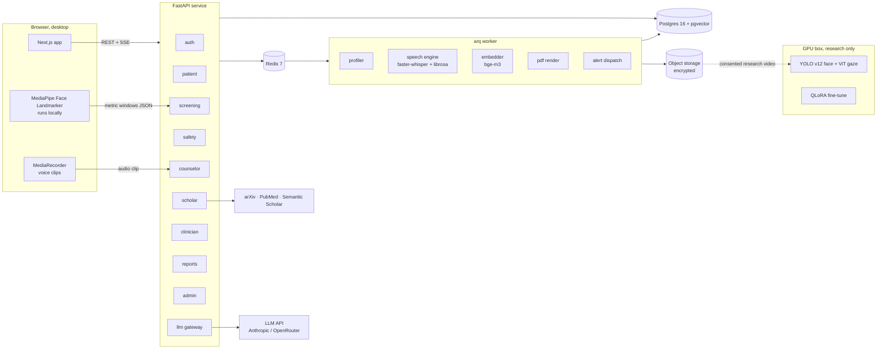
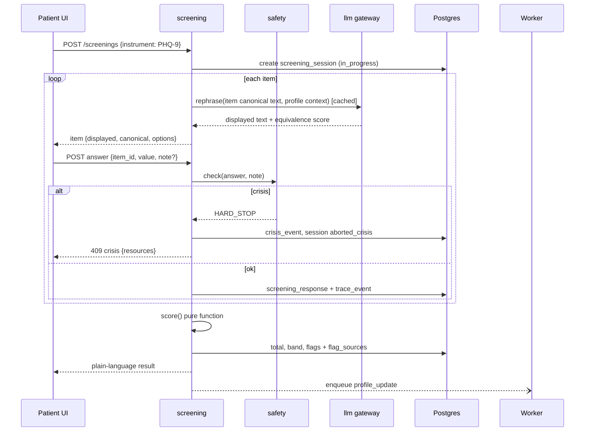
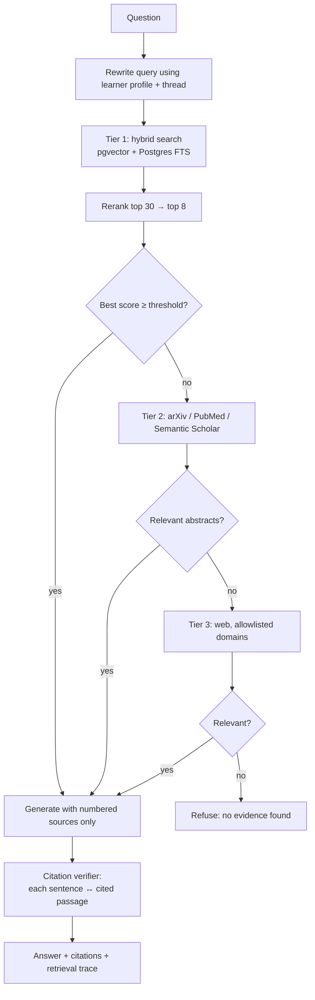

# Technical Requirements Document

Related: [[PRD]] · [[Backend-Schema]] · [[API]] · [[Decisions]] · [[Rules]]

## 1. Architecture at a glance

We build a modular monolith: one FastAPI service split into modules with hard boundaries, one background worker process for slow AI jobs, one Postgres database with pgvector, one Redis. The Next.js app talks only to the API.



### Why this shape

- Three developers, one deploy target, 23 weeks. Microservices would cost more in plumbing than they return. ([[Decisions#ADR-001]])
- Module boundaries follow data boundaries. The scholar module connects to Postgres with a role that has no grant on patient tables, so a bug cannot leak patient data into RAG. ([[Decisions#ADR-004]])
- Slow work (transcription, embeddings, profiling, PDFs) goes through Redis to the worker so API latency stays flat.
- Vision runs in the browser by default. Raw video never leaves the patient's machine unless they give research consent. ([[Decisions#ADR-006]])

## 2. Stack

| Layer | Choice | Version | Notes |
|---|---|---|---|
| Frontend | Next.js App Router, React, TypeScript | 15.x, 19.x, 5.x | Server components for shells, client components for live UI |
| Styling | Tailwind CSS | 4.x | Tokens from [[Brand-Kit]] as CSS variables |
| Components | shadcn/ui (restyled), Radix primitives | latest | Restyle to brand; no default shadcn look |
| Data fetching | TanStack Query | 5.x | Server state |
| Client state | Zustand | 5.x | Only for session-local UI state (crisis lock, capture toggles) |
| Forms | react-hook-form + zod | latest | Zod schemas generated from OpenAPI |
| Charts | visx | latest | Timeline and marker charts, full control over look |
| Vision (browser) | @mediapipe/tasks-vision Face Landmarker | 0.10.x | 478 landmarks + blendshapes, runs on WebGL/WASM |
| API | FastAPI, Pydantic v2 | 0.115+, 2.x | Python 3.12 |
| ORM and migrations | SQLAlchemy 2 async, Alembic | 2.x | asyncpg driver |
| Jobs | arq on Redis | latest | Simple async jobs, retries, cron |
| Package mgmt | uv (Python), pnpm (JS) | latest | Monorepo with pnpm workspaces |
| Database | PostgreSQL + pgvector | 16, 0.7+ | HNSW index for embeddings |
| Cache and queue | Redis | 7 | Rate limits, SSE fan-out, job queue |
| Object storage | S3-compatible (GCS in prod, local MinIO in dev) | | Server-side encryption; research recordings only |
| LLM gateway | Anthropic SDK, OpenRouter via OpenAI-compatible client | | Provider interface in `llm/` |
| Embeddings | BAAI bge-m3 (1024 dims) | | Multilingual; handles Roman Urdu better than English-only models |
| Reranker | BAAI bge-reranker-v2-m3 | | Cross-encoder on top 30 hits |
| Speech | faster-whisper, librosa, praat-parselmouth | | Whisper small on CPU for FYP, large-v3 on GPU for research |
| Risk classifier | Fine-tuned DistilRoBERTa exported to ONNX | | Runs in API process, CPU, under 30 ms |
| PDF | WeasyPrint (HTML to PDF) | 62+ | Same templates as web views |
| Research vision | Ultralytics YOLO v12 (face), ViT gaze model | | GPU box only |
| Fine-tuning | Hugging Face Transformers, PEFT QLoRA, TRL | | Gemma 3 or Qwen 3, 4B to 12B |
| Testing | pytest, Hypothesis, Vitest, Playwright, k6 | | See section 10 |
| Observability | structlog JSON logs, OpenTelemetry traces, Sentry | | PII scrubbing before export |

## 3. Repository layout

```
zehensync/
  apps/
    web/                 Next.js
      app/(auth)/        signup, login, role fork
      app/(patient)/     home, intake, screen, counselor, timeline, sharing
      app/(clinician)/   queue, patients/[id], flags/[id], exports
      app/(scholar)/     tutor, sources, simulator, profile
      app/(admin)/       verification, corpus, audit
      components/        ui/ (restyled shadcn), domain/
      lib/               api client (generated), capture/, crisis/
    api/
      app/
        core/            config, db pools, security, audit, errors
        modules/
          auth/ patient/ screening/ safety/ counselor/
          scholar/ clinician/ reports/ admin/ profiling/
        llm/             provider interface, prompts/, guards
        workers/         arq tasks
      migrations/
      tests/
  packages/
    instruments/         JSON definitions + Python scoring + golden tests
    crisis-lexicon/      versioned lexicon (en, roman-ur), eval sets
    tokens/              design tokens (CSS vars, TS export)
  research/
    vision/              YOLO + ViT pipeline, notebooks, eval
    speech/              feature extraction eval
    finetune/            Psyche-Corpus build, QLoRA scripts, benchmarks
  docs/                  this vault
  infra/                 docker-compose, Dockerfiles, deploy scripts
```

Each module under `modules/` owns `router.py`, `service.py`, `models.py`, `schemas.py`, `tests/`. Modules call each other through `service.py` only, never through another module's models.

## 4. Identity, roles, access

- **Auth:** email and password, Argon2id hashes. Access token (JWT, 15 min) in memory; refresh token (opaque, 14 days, rotating, reuse detection) in an httpOnly, Secure, SameSite=Strict cookie.
- **2FA:** TOTP, required for `clinician` and `admin` before any patient data loads.
- **Roles:** `patient`, `scholar`, `clinician`, `admin`. One role per account. A person who is both a student and a patient uses two accounts; we do not merge contexts.
- **Enforcement layers:**
  1. Route dependency `require_role(...)` on every router.
  2. Service-level ownership checks (patient sees own rows; clinician sees rows of actively linked patients with matching share scope).
  3. Postgres row-level security on `patient.*` tables using `app.user_id` and `app.role` session settings.
  4. Separate DB login roles per connection pool: `zs_patient_app`, `zs_scholar_app`, `zs_clinician_app`, `zs_admin_app`. `zs_scholar_app` has zero privileges on schema `patient`.
- **Pseudonyms:** each patient gets a stable pseudonym like `ZS-7F3K-2Q` generated at signup. Clinician views show the real name only for linked patients who shared scope `identity`. Aggregate and research views use pseudonyms only.

## 5. Patient pipelines

### 5.1 Screening (Guided Volition)



Rules the code must hold:

- `score()` lives in `packages/instruments`, takes answers, returns score and band, has no I/O, and ships with golden tests for every boundary value.
- Rephrasing uses the small model at temperature 0.3 with the canonical text, item intent and a reading-level target. A second call scores semantic equivalence; below 0.85 we show the canonical text instead. Results are cached per (item, profile bucket, model version).
- The stored response keeps `canonical_text`, `displayed_text`, `rephrase_model`, `value`, and `answered_at`. A clinician can always see both texts.

### 5.2 Counselor chat

- Transport: `POST /counselor/threads/{id}/messages` returns an SSE stream.
- Before generation: the safety check runs synchronously on the user message (lexicon, classifier). If it trips, no LLM call happens.
- During generation: tokens stream through an output guard that buffers per sentence and blocks diagnostic labels, medication names with dosing, and certainty claims. A blocked sentence gets replaced with a safe line and logged.
- System prompt: CBT persona, reflective listening, motivational interviewing, Socratic questions, SDOH summary, profile summary, list of available instruments. It never sees other users' data.
- Trigger routing: the model can call one tool, `suggest_instrument(code, reason)`. The UI renders a card with Accept and Not now. The model cannot start an instrument by itself.
- Voice: browser records up to 60 s with MediaRecorder (Opus/WebM), uploads the clip, worker transcribes with faster-whisper and extracts features, patient sees the transcript and confirms before it posts. Audio deletes after feature extraction unless research consent exists.

### 5.3 Safety

Detailed in [[Safety-Protocol]]. Engineering summary:

| Detector | Where | Latency budget | Output |
|---|---|---|---|
| Lexicon matcher (Aho-Corasick over normalised text, English + Roman Urdu variants) | API, sync | < 5 ms | match list |
| Risk classifier (DistilRoBERTa ONNX, 4 classes: none, distress, self-harm, harm-to-others) | API, sync | < 30 ms | class + probability |
| Item rules (PHQ-9 item 9 > 0, C-SSRS items per rubric) | screening service | < 1 ms | rule id |

Any detector firing creates a `crisis_event`, aborts the response, returns HTTP 409 with `code: CRISIS_HARD_STOP`, and enqueues `alert_clinician`. The frontend treats that code as a global event: the crisis store locks every route behind the crisis screen until the patient taps "I'm safe right now" or exits. A crisis screen visit also appears in the header as a permanent "Get help now" link.

### 5.4 Behavioural capture (browser)

- MediaPipe Face Landmarker in a Web Worker at 15 fps.
- Per frame: eye aspect ratio from landmarks, blendshape `eyeBlinkLeft/Right`, iris centre relative to eye corners, head yaw/pitch/roll from the transformation matrix.
- Per 10 s window: blink count and rate, mean and SD of EAR, gaze dispersion, fixation count (dispersion threshold algorithm), head pose SD, face-present ratio, mean luminance.
- Quality gate per window: face present at least 80%, luminance within range, head yaw within ±30°. Failing windows get `quality_ok = false`.
- The browser posts windows in batches every 30 s. No frames leave the device.
- Calibration: a 20 s neutral baseline at session start (look at dot, blink normally).

### 5.5 Speech features (worker)

- faster-whisper with word timestamps.
- Features: speech rate (words/min excluding pauses), pause count and mean length (gaps > 250 ms), long pause ratio (> 1 s), filler rate (um, uh, matlab, yaani, and the Roman Urdu list), F0 mean and SD, jitter and shimmer via parselmouth, energy SD.
- Quality: SNR estimate, clip length at least 5 s.

### 5.6 Research vision (GPU, consent only)

- Upload over resumable HTTPS to object storage, encrypted.
- Pipeline: YOLO v12 face detection, crop, ViT gaze estimation, blink detection with a CNN (EfficientNet) and a ViT for the architecture comparison.
- Output lands in `biomarker_windows` with `source = server_research`, so analysis can compare browser and server numbers on the same session.

## 6. Scholar pipeline



- **Chunking:** by heading structure first, then 350 to 500 tokens with 60-token overlap. Each chunk stores source, page range, section path.
- **Hybrid search:** cosine on bge-m3 embeddings plus `ts_rank` on a `tsvector`, merged with reciprocal rank fusion.
- **Generation:** the model receives numbered passages and must cite with `[n]`. A sentence without a citation that makes a factual claim fails verification.
- **Verifier:** a small-model pass checks each (sentence, passage) pair for support. Unsupported sentences get removed; if more than a third fail, the tutor refuses.
- **Refusal text:** "I can't find evidence for this in the sources I have. Try rephrasing, or ask about a specific disorder or criterion."
- **Learner persona:** level (`intro`, `intermediate`, `advanced`, `research`) sets vocabulary and depth. The profile never changes the facts, only the explanation.
- **Simulator:** a case card (from a vignette in the corpus) defines the synthetic patient's history, symptoms, affect, and what they disclose only when asked well. The simulator model stays in character; a separate debrief call scores the student's interview against a rubric (rapport, open questions, risk assessment asked, criteria coverage) with citations.

## 7. Profiling engine

- Trigger events: `screening.completed`, `counselor.thread_closed` (idle 20 min or explicit end), `scholar.thread_idle`, `sim.completed`.
- Worker loads the current profile state and the new transcript or results, calls the small model with a strict JSON schema, validates with Pydantic, stores the patch in `profile_patches`, applies it with JSON Merge Patch, increments `version`.
- Patient profile fields: themes (with first seen, last seen, count, source event IDs), instrument baselines (rolling mean of last 3), deltas, suggested next instrument, risk notes (never a diagnosis), communication preferences.
- Scholar profile fields: level, focus areas, weak topics with evidence, clarification rate, preferred format.
- Rapid-change rule (deterministic, not LLM): if a score rises by at least 5 points against the rolling baseline within 14 days, raise a `rapid_delta` flag with both sessions as sources.

## 8. LLM gateway

- Interface: `complete()`, `stream()`, `json()` with typed prompts in `llm/prompts/*.py`, each with an ID and version stored on every output row.
- Default routing (FYP): counselor, simulator and clinical assistant on Claude Sonnet 5; rephrase, equivalence, profiler, citation verifier on Claude Haiku 4.5. OpenRouter as fallback provider.
- Swap-in: a `vllm` provider for the fine-tuned Gemma 3 or Qwen 3 model, selectable per task by config. Phase 9 benchmarks the swap.
- Guards: input PII scrub for anything leaving to a third-party API (names, phone numbers, CNIC patterns replaced with placeholders), output guard (section 5.2), token and cost limits per user per day.
- Data policy: API calls run with zero data retention where the provider supports it.

## 9. Non-functional requirements

| Area | Requirement |
|---|---|
| Latency | CRUD p95 < 200 ms; questionnaire submit and score p95 < 2 s at 50 concurrent users; counselor TTFT p95 < 1.5 s; tutor full answer p95 < 12 s; export < 5 s |
| Availability | FYP target 99% during demo weeks; health checks on API, worker, DB, Redis |
| Security | TLS everywhere; Argon2id; rotating refresh; CSRF protection on cookie endpoints; rate limits (auth 10/min/IP, chat 30/min/user); OWASP ASVS L2 checklist |
| Privacy | Application-level AES-GCM encryption for chat content, notes, SDOH free text, transcripts; keys in environment secret store; pseudonyms in all non-linked views |
| Data retention | Voice clips deleted after features; research recordings kept per consent term (default 24 months); account deletion removes personal data within 30 days, keeps anonymised aggregates |
| Audit | Append-only `audit.events` with hash chain; every clinician read of patient data logged |
| Accessibility | WCAG 2.2 AA; full keyboard use; reduced-motion honoured; minimum 16 px body text in patient area |
| Browser support | Latest Chrome, Edge, Firefox on desktop. Safari best effort (MediaPipe performance varies). |

## 10. Testing strategy

| Level | Tooling | Must cover |
|---|---|---|
| Unit | pytest, Hypothesis, Vitest | Every scoring function at every band boundary (100%), lexicon normalisation, patch application, permission checks |
| Safety eval | pytest suite over `packages/crisis-lexicon/eval` | Recall 100% on crisis set, FP < 5% on benign set; runs in CI, blocks merge |
| Integration | pytest with Postgres in Docker | Answer submit to trace event to flag to clinician view; RLS denies cross-patient reads |
| Contract | schemathesis against OpenAPI | Every endpoint validates inputs and error shape |
| E2E | Playwright | Signup fork, full PHQ-9, crisis lock, share and revoke, clinician trace, tutor citation click |
| Load | k6 | Questionnaire flow at 50 VUs |
| LLM evals | Custom harness, JSON results in `research/evals` | Rephrase equivalence, tutor citation precision, refusal rate, simulator rubric agreement |
| Security | bandit, pip-audit, npm audit, OWASP ZAP baseline | Before each release |

Definition of Done: code reviewed, tests green, safety eval green, RTM row updated, deployed to staging, acceptance criteria verified by someone other than the author.

## 11. Environments and deployment

| Env | Frontend | Backend | Data |
|---|---|---|---|
| Local | `pnpm dev` | `uv run fastapi dev` + `arq` | docker-compose: Postgres+pgvector, Redis, MinIO |
| Staging | Vercel preview | GCP VM (e2-standard-4) with Docker Compose | Same VM, nightly encrypted backup to GCS |
| Demo / prod | Vercel | Same VM class, separate project | Cloud SQL Postgres 16 with pgvector if budget allows, else VM |
| Research GPU | n/a | RunPod or GCP spot GPU, on demand | Pulls consented recordings, writes results back |

CI on GitHub Actions: lint, type-check, unit, safety eval, integration, build. Deploy to staging on merge to `main`.

## 12. Open technical questions

- Pakistan data-residency expectations from the pilot clinic: may force a regional host. Revisit at Phase 6.
- Whisper quality on Urdu-English code-switching: measure in Phase 7 before promising voice features for Roman Urdu speakers.
