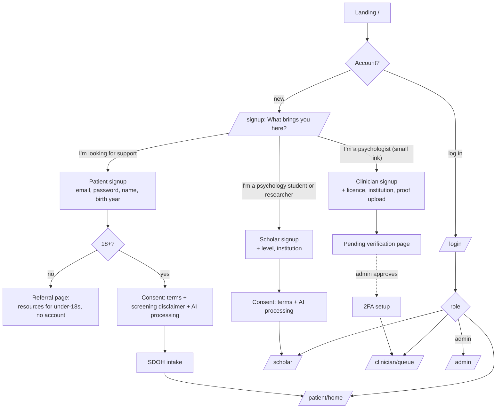
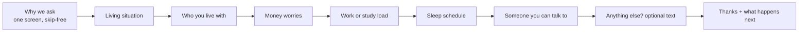
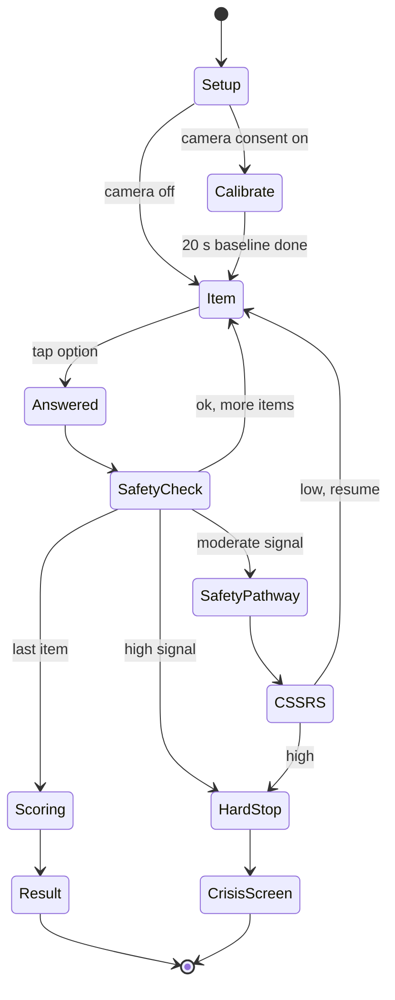
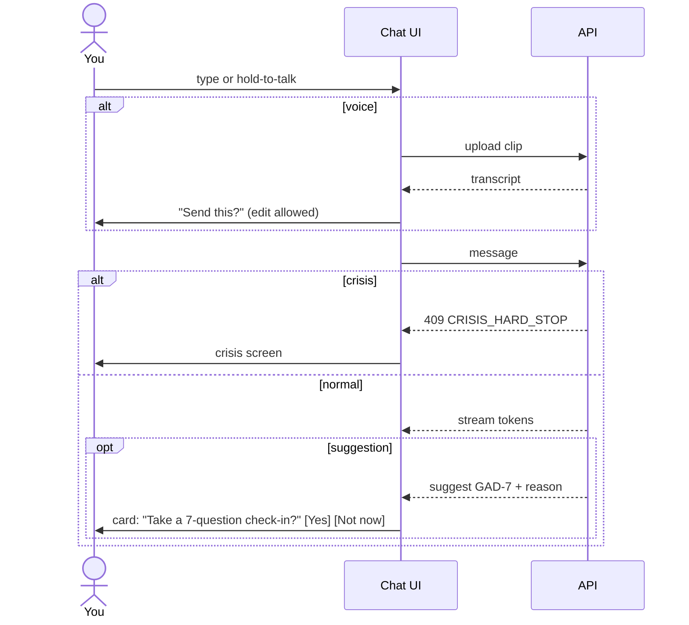
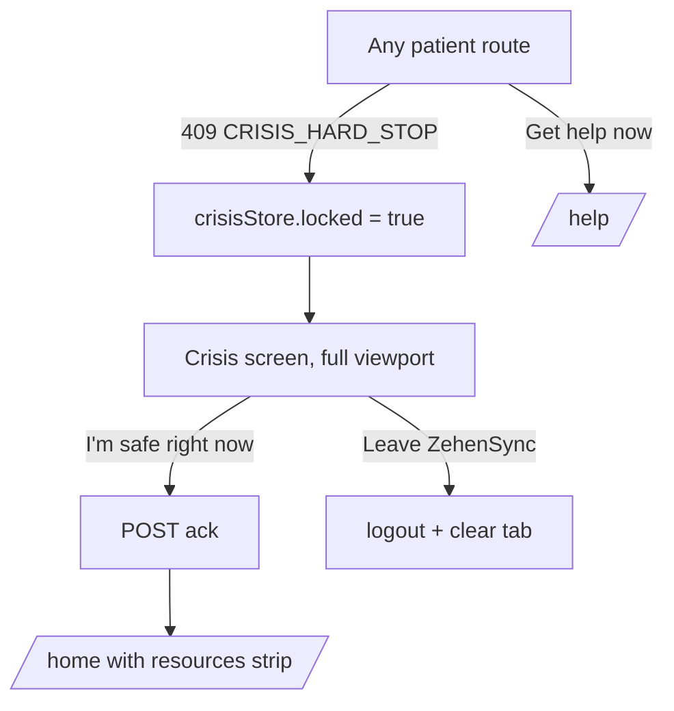
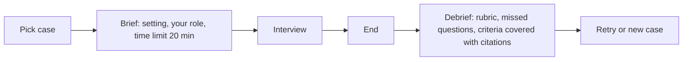

# App Flow

Related: [[PRD]] · [[Design-System]] · [[API]] · [[Safety-Protocol]]

Desktop web. Four role areas share one app shell with a role-specific sidebar. The crisis layer sits above all patient routes.

## 1. Entry and role fork



Notes:

- The fork uses plain language. We never show the word "patient" to the person seeking support; the UI says "you".
- Psychologist signup sits behind a small text link so a distressed person doesn't pick it by mistake.
- Returning patients with an incomplete intake resume at the last answered question.

## 2. Patient

### 2.1 Sitemap

| Route | Screen |
|---|---|
| `/home` | Today: suggested next step, last result card, quick actions (Check in, Talk, My history) |
| `/intake` | SDOH intake, one question per view |
| `/check-in` | Instrument picker (suggested first, then all) |
| `/check-in/[session]` | Guided Volition runner |
| `/check-in/[session]/result` | Plain-language result |
| `/talk` | Counselor thread list, new chat |
| `/talk/[thread]` | Counselor chat |
| `/history` | Timeline charts and session list |
| `/sharing` | Psychologist links and scopes |
| `/settings` | Consents, camera and mic defaults, export, delete account |
| `/help` | Crisis screen (always reachable) |

### 2.2 SDOH intake



- One question per view, 4 to 6 option buttons, "Prefer not to say" on each.
- Progress shown as "3 of 7", not a percentage bar.
- Answers autosave. Back button always works.

### 2.3 Guided Volition runner (state machine)



Item view layout, top to bottom:

1. Timeframe line in muted text: "Over the last 2 weeks".
2. The question, large (24 px), rephrased. Below it a small link: "Show original wording".
3. Answer buttons stacked full width, 56 px tall, keyboard keys 1 to 4 shown on the right edge of each.
4. Optional "Add a note" disclosure.
5. Footer: Back, progress "4 of 9", camera indicator dot if capture is on (click to pause).

After the last item: a 1 s "Adding up your answers" state (the scoring itself is instant; the pause lets the transition read as deliberate), then the result.

### 2.4 Result view

- Headline in plain words from [[Instruments]] band wording.
- A single horizontal band bar showing where the score falls. Score number shown small, beneath, labelled "Score 12 of 27".
- "What you can do next": 2 or 3 actions (talk to the counselor, share with your psychologist, check in again in 2 weeks).
- If linked: "Dr. (name) can see this result." Otherwise: "Want a psychologist to see this?"

### 2.5 Counselor chat



- Chat column max 680 px, centred. Assistant messages have no avatar bubble; they read as text on the page. User messages sit in a tinted block aligned right.
- A slim context strip above the composer: camera on or off, mic on or off, "End chat".
- Ending a chat shows "Anything you'd like to remember from today?" (optional note), then returns home.

### 2.6 Sharing

1. Patient enters the psychologist's invite code.
2. The app shows the psychologist's name, institution, verification badge.
3. Patient picks scopes with checkboxes, each with one line explaining it: Name and contact, Scores, How answers led to flags, Chat transcripts, Camera and voice measurements, Background (intake).
4. Confirm. The link becomes active. Revoke is one click with confirm.

## 3. Crisis layer



- While locked, navigation, back button and deep links all render the crisis screen.
- The lock persists across reloads for 30 minutes (session storage plus server state).
- Content and rules: [[Safety-Protocol#3. Crisis screen]].

## 4. Psychologist

| Route | Screen |
|---|---|
| `/clinician/queue` | Triage queue |
| `/clinician/patients/[pid]` | Patient overview (tabs: Summary, Check-ins, Flags, Conversations, Measurements, Notes) |
| `/clinician/flags/[fid]` | Flag trace |
| `/clinician/exports` | Export history |
| `/clinician/assistant` | Cited assistant |
| `/clinician/settings` | Invite code, 2FA, notification prefs |

### 4.1 Queue

Dense table. Columns: severity marker, patient (name or pseudonym), latest instrument and score, change vs baseline (arrow and number), open flags count, last activity, linked since. Default sort: crisis, urgent, rapid change, watch, then oldest unreviewed. Row click opens the overview.

### 4.2 Flag trace (the core screen)

```
┌──────────────────────────────────────────────────────────────────────────┐
│ URGENT · Rapid increase in depression score        ZS-7F3K-2Q · open   │
│ Rule PHQ9.delta.gte5 v1.0 · raised 20 Nov 2026 14:06                     │
├──────────────────────────────────────────────────────────────────────────┤
│ Why this flag exists                                                     │
│ PHQ-9 rose from a baseline of 4.3 (3 sessions) to 12 within 9 days.     │
├──────────────────────────────────────────────────────────────────────────┤
│ Evidence                                             ○ baseline ● trigger│
│ ● 20 Nov 14:05  PHQ-9 session  total 12  (moderate)          open ▸     │
│     Item 2  "Feeling down, depressed, or hopeless"                        │
│             shown as: "How often have you felt low or hopeless?"          │
│             answer: More than half the days (2)                           │
│ ○ 11 Nov 10:12  PHQ-9 session  total 4                         open ▸     │
│ ○ 03 Nov 18:40  PHQ-9 session  total 5                         open ▸     │
│ Context  SDOH: financial strain, night-shift work                        │
│ Context  Chat 19 Nov 22:14 "i haven't slept properly in days"  open ▸    │
├──────────────────────────────────────────────────────────────────────────┤
│ [Acknowledge]  [Resolve]  [Add note]                   [Export evidence] │
└──────────────────────────────────────────────────────────────────────────┘
```

Every evidence row shows timestamp, source type, the exact stored value, and for items both canonical and displayed wording.

## 5. Scholar

| Route | Screen |
|---|---|
| `/scholar` | Home: continue threads, suggested topics from learner profile, simulator cases |
| `/scholar/ask/[thread]` | Tutor: answer column + references sidebar |
| `/scholar/sources` | Browse corpus sources |
| `/scholar/sim` | Case library |
| `/scholar/sim/[session]` | Interview view: transcript, case card (collapsed), timer, End interview |
| `/scholar/sim/[session]/debrief` | Rubric scores with cited feedback |
| `/scholar/profile` | What the tutor has learned about you; edit level, clear profile |

### 5.1 Tutor layout

Two columns at 1280 px and above: answer column (max 720 px) and a 380 px reference sidebar. Citations render as small superscript numbers in the lapis accent. Clicking one scrolls the sidebar to the passage and highlights the quoted sentence. A "How I found this" disclosure under each answer shows tiers tried and top scores. Refusals render as a plain notice with suggestions, never as an apology paragraph.

### 5.2 Simulator



The case card stays hidden during the interview (students don't see the diagnosis). The debrief reveals it.

## 6. Admin

`/admin/clinicians` verification queue with proof viewer, `/admin/corpus` sources with index status, `/admin/audit` search, `/admin/safety` crisis events without a linked psychologist, `/admin/health`.

## 7. Empty, loading and error states

| Situation | Behaviour |
|---|---|
| No check-ins yet | Home shows one card: "Start with a 2-minute well-being check-in" (WHO-5) |
| Queue empty | "No linked patients yet. Share your invite code: ABC-123" with copy button |
| Tutor slow | Stream shows retrieval stage names ("Searching DSM-5-TR", "Checking recent papers") rather than a spinner |
| LLM provider down | Patient: rephrasing falls back to canonical text; counselor shows "The counselor is unavailable right now" with the resources strip. Scholar: "The tutor is unavailable." Check-ins keep working. |
| Camera blocked | Check-in continues without capture; a single dismissible note explains how to allow it |
| Network drop mid check-in | Answers queue locally and resend; no answer lost |
