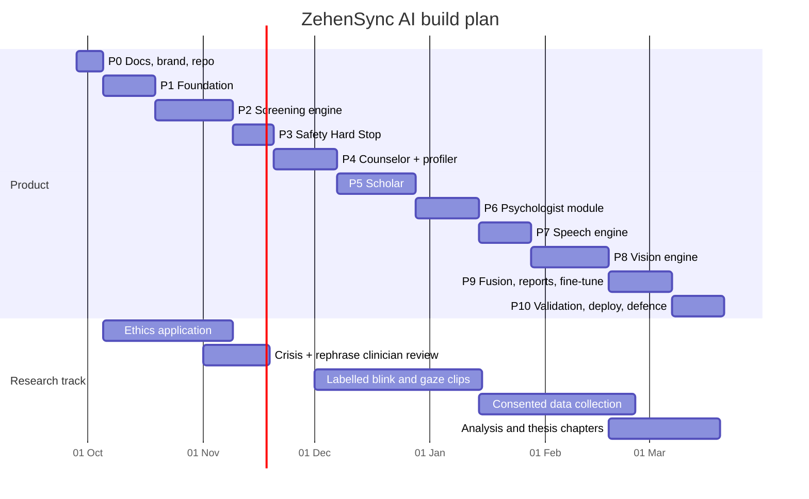

# Phases

Related: [[Tracker]] · [[RTM]] · [[PRD]]

From 28 Sep 2026 to 20 Mar 2027: 11 phases in 25 weeks, plus a research track running alongside. Each phase ends with a demo to the advisor and a written exit check. A phase does not close until its exit criteria pass.

Evaluation dates for FYP-1 and FYP-2 are not confirmed yet ([[PRD#11. Open questions]]). When they arrive, move the nearest phase demo onto the evaluation date.

## P0 · Docs, brand, repo · 28 Sep to 4 Oct

**Goal:** everyone builds from the same plan.
**Delivers:** this vault, brand kit, logo, tokens, monorepo skeleton, CI stub.
**Exit:** team and advisor review PRD, App Flow and Rules; logo chosen; repo pushed to GitHub with branch protection.

## P1 · Foundation · 5 Oct to 18 Oct

**Goal:** a person can sign up into the right world and nothing leaks between worlds.
**Delivers:** pnpm + uv monorepo, docker-compose (Postgres + pgvector, Redis, MinIO), FastAPI skeleton with module layout, Alembic baseline for all five schemas, DB roles and RLS, auth (signup fork, login, refresh rotation, 2FA), consent centre, audit log with hash chain, Next.js shell per role with restyled components and tokens, admin clinician verification, CI (lint, type, test, build).
**Exit:** E2E: patient, scholar and clinician sign up and land in their area; an integration test proves the scholar DB role cannot select from `patient.*`; audit chain verifies.

## P2 · Screening engine · 19 Oct to 8 Nov

**Goal:** a patient completes a PHQ-9 with rephrased questions and gets a correct, explained result.
**Delivers:** `packages/instruments` with PHQ-9, GAD-7, WHO-5, C-SSRS screener definitions and scoring, Hypothesis boundary tests, SDOH intake, check-in runner UI, rephrase + equivalence pipeline with cache, trace events, rule-based flags with sources, result view, timeline, instrument risk rules wired to a stub safety response.
**Exit:** 100% scoring tests pass; a completed PHQ-9 is reproducible from stored responses; every flag has sources; p95 submit under 2 s at 50 users.

## P3 · Safety Hard Stop · 9 Nov to 19 Nov

**Goal:** no crisis signal slips through, and the patient always reaches help.
**Delivers:** crisis lexicon v1 (English + Roman Urdu) with normaliser, classifier v1 (ONNX), golden and benign eval sets, safety pathway and Hard Stop in API, crisis screen and global lock in web, psychologist alert job, output guard library, admin safety dashboard, clinician sign-off on lexicon and screen.
**Exit:** recall 100% on golden set, FP under 5% on benign set, E2E crisis test passes, helpline numbers verified by phone, clinician sign-off recorded.

## P4 · Counselor and profiler · 20 Nov to 6 Dec

**Goal:** a patient can talk, and the system remembers what matters without drifting.
**Delivers:** LLM gateway with provider interface, counselor prompt v1, SSE streaming by sentence through the guard, `suggest_instrument` tool and card, voice input (record, transcribe, confirm), profiler worker with JSON patches, rapid-delta rule, patient home suggestions, research capture kit v0 (consent flow + recorder) so data collection can start in January.
**Exit:** crisis message mid-chat never renders AI text; counselor passes a 40-case behaviour eval (no diagnosis, no medication, psychosis neutrality); profiler patches validate against schema 100%.

## P5 · Scholar · 7 Dec to 27 Dec

**Goal:** students get cited answers or an honest refusal.
**Delivers:** corpus ingestion (PDF parse, heading-aware chunking, bge-m3 embeddings, HNSW), hybrid search + reranker, generation with numbered sources, citation verifier, refusal, reference sidebar, Tier 2 (arXiv, PubMed, Semantic Scholar), learner profile and persona levels, simulator with 5 cases and debrief rubric.
**Exit:** citation precision at least 90% and refusal correctness at least 95% on the eval set; simulator debrief agrees with a human rater on at least 4 of 5 rubric areas across 10 sessions.

## P6 · Psychologist module · 28 Dec to 13 Jan

**Goal:** a psychologist trusts a flag because they can see exactly why it exists.
**Delivers:** invite codes, linking with scopes and revoke, queue, patient overview tabs, flag trace view, reviews and notes, clinical export (PDF + JSON via WeasyPrint), alerts inbox, clinician assistant (P1 priority, cited, no diagnosis).
**Exit:** E2E: patient shares, psychologist traces a flag to item level, exports PDF under 5 s; revoking a scope removes access immediately (RLS test).

## P7 · Speech engine · 14 Jan to 27 Jan

**Goal:** voice clips produce reliable acoustic markers.
**Delivers:** faster-whisper with word timestamps, pause, rate, filler (English + Roman Urdu), pitch, jitter, shimmer features, quality checks, features stored on clips, clinician marker panel for speech, Whisper code-switching benchmark.
**Exit:** feature extraction matches manual annotation on 30 clips within 10% for pause count and speech rate.

## P8 · Vision engine · 28 Jan to 17 Feb

**Goal:** a normal webcam yields blink and gaze metrics good enough to report with confidence levels.
**Delivers:** MediaPipe Face Landmarker in a Web Worker, calibration step, EAR blink detection, iris gaze, fixations, head pose, quality gate, window batching, clinician marker panel for vision; research pipeline on GPU (YOLO v12 face, ViT gaze, CNN vs ViT blink comparison) over consented recordings.
**Exit:** blink F1 at least 0.85 on labelled clips in good light; browser pipeline holds 15 fps on a mid-range laptop; research comparison table produced.

## P9 · Fusion, reports, fine-tune · 18 Feb to 6 Mar

**Goal:** one report brings answers, words and behaviour together; and we know whether our own model beats the API.
**Delivers:** fusion summary section in clinical export (markers beside scores with ranges and quality), patient summary polish, Psyche-Corpus build, QLoRA fine-tune of Gemma 3 or Qwen 3, benchmark against API on scholar and counselor evals, vLLM provider.
**Exit:** benchmark report written; the better model per task is selected by config; exports include fusion section.

## P10 · Validation, deploy, defence · 7 Mar to 20 Mar

**Goal:** a defensible system and thesis.
**Delivers:** correlation analysis (markers vs PHQ-9/GAD-7), security pass (ZAP, audits, ASVS checklist), load test, production deploy, demo seed data, thesis chapters, defence deck built on the brand kit.
**Exit:** all P0 requirements green in [[RTM]]; defence rehearsed twice.

## Post-FYP

Marketplace (verified psychologist directory, booking, payments, escrow, telehealth rooms), Urdu script UI with validated Urdu instruments, adolescent instruments with guardian consent, mobile app, SMS alerts, anonymised cohort analytics for university counselling centres.
